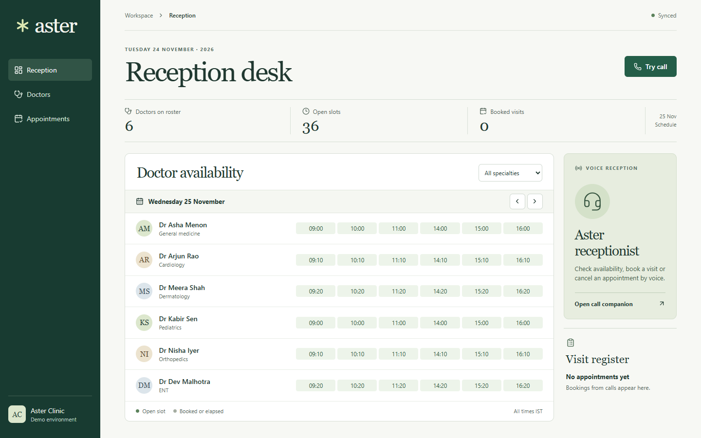

# Aster · Voice Reception

A local fictional clinic desk with a browser voice companion. Six doctors share a SQLite schedule. Receptionists can see a booking or cancellation arrive in another open tab. The voice worker uses ElevenLabs Scribe Realtime, Google Gemini 2.5 Flash function calling, and ElevenLabs Flash TTS. All three services run on the Python side.

**Readiness:** the dashboard, database, browser media transport and structured receipts have been exercised. A complete spoken booking through both providers still needs verification. See [testing evidence](docs/testing.md).



## Run on Windows

Prerequisites are 64-bit Python 3.12, Node 24 with npm, a current WebRTC browser and a microphone. Edge was tested. Run from the repository root in PowerShell. This project does not require Docker, a database server or a hosted WebRTC account.

```powershell
py -3.12 -m venv .venv
.\.venv\Scripts\python -m pip install -r backend/requirements.lock
npm --prefix frontend ci
npm --prefix frontend run build
Copy-Item .env.example .env
```

Skip environment creation and installation if using the prepared workspace. Copy the example only for first-time setup. An alternative when the Python launcher cannot locate 3.12 is `uv venv --python 3.12` followed by `uv pip install -r backend/requirements.lock`. On Linux use the virtual environment executable at `.venv/bin/python`. The supplied Python lock was resolved on Windows.

**Configure locally** in the root `.env` or shell environment. Existing shell variables take precedence.

| Name | Value |
| --- | --- |
| ELEVENLABS_API_KEY | ElevenLabs API key with access to realtime speech recognition and text-to-speech. Check the available quota and voice access in your account. |
| GEMINI_API_KEY | Google AI Studio key with free-tier access to generate content with the selected Gemini model. |
| ELEVENLABS_VOICE_ID | Optional accessible ElevenLabs voice. The example supplies a default. |
| GEMINI_MODEL | Defaults to gemini-2.5-flash. A replacement must support text inference with function calling and have available quota. |
| ASTER_DB | Optional filesystem path for the SQLite database. Defaults to aster.sqlite at the repository root. |

```powershell
.\.venv\Scripts\python -m uvicorn backend.main:app --host 127.0.0.1 --port 8000 --no-access-log
```

Open [the reception desk](http://127.0.0.1:8000). Restart the server after changing keys. The same process serves the production frontend, REST, SSE and WebRTC signaling. For frontend development, keep it running and use `npm --prefix frontend run dev` in another terminal. Vite proxies the API. Use the local address it prints.

## Make a call

1. Select **Try call**, allow microphone access and listen for the greeting. If playback is blocked, select **Enable speaker**.
2. Say a fictional ten-digit Indian mobile number. Listen to every digit and explicitly confirm or correct it.
3. Ask for a doctor by name or specialty and date. Choose an offered slot. Check the spoken result, structured receipt and visit register.
4. Ask to cancel in the same conversation. Select the visit if needed. Answer the specific cancellation question. The visit stays in history and its future slot becomes available again.
5. End or close the call. Starting another call creates a fresh conversation. Other tabs can see committed schedule changes even after the original call closes.

The roster opens on the next day after today's slots elapse. Dates use Asia/Kolkata. Fictional slots are generated on demand for today through the next 30 days. Clinics and visits exist only in your selected SQLite file. The register masks phone numbers. The active transcript can contain the number the caller spoke and readback. Audio and transcripts are not saved by the application.

## Verify

```powershell
.\.venv\Scripts\python -m pytest -q
npm --prefix frontend run build
npm --prefix frontend test
```

Browser tests launch an isolated loopback server and temporary database on port 8011. They require Edge or an installed Playwright-compatible Chrome channel selected with `ASTER_BROWSER`. They use a synthetic microphone and a test worker. The normal server always uses the provider pipeline. To exercise Gemini alone with available free quota, explicitly run `.\.venv\Scripts\python -m tests.live_gemini`. This makes a real inference request. Browser screenshots of the running production app can be refreshed with `node frontend/tests/capture.mjs final`.

## Troubleshooting

- **Voice setup required** lists missing keys. The dashboard remains usable without them.
- **HTTP 429** from Gemini means the request hit a provider limit. Inspect the model and quota in AI Studio. Listing the model does not prove generation quota.
- **Microphone denied or absent** needs browser site permission and a working OS input device. Use localhost on the same machine. A remote phone accessing an insecure LAN URL may lack microphone access.
- **Connection failure** can result from local firewall or network restrictions. This localhost configuration has no TURN relay. The phone-sized screenshot uses browser emulation.
- **Slot unavailable** means availability changed or the selected slot was never offered in this call. Ask for fresh choices.

## Repository guide

- [Runtime, file map and alternatives](docs/architecture.md)
- [Dependency and provider research](docs/research.md)
- [Requirements and acceptance evidence](docs/requirements-matrix.md)
- [Design decisions](docs/design-system.md) and [screenshots](docs/evidence/)
- [Testing, limitations and readiness](docs/testing.md)
- [Three-minute demonstration plan](docs/demo-script.md)
- [Interview study notes](docs/interview.md) and [build log](docs/progress.md)

AI assistance generated the implementation, tests and engineering notes in this session. The candidate confirmed free-tier status and authorized two bounded Gemini probes. Candidate authorship, manual code review and a successful candidate-spoken call require separate evidence. The submission form asks for a pipeline explanation in the candidate's own words.
